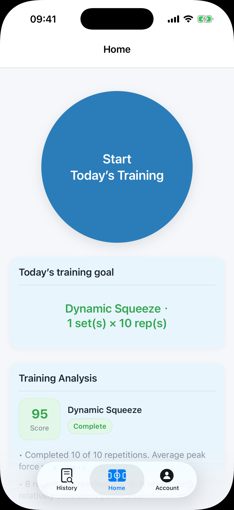
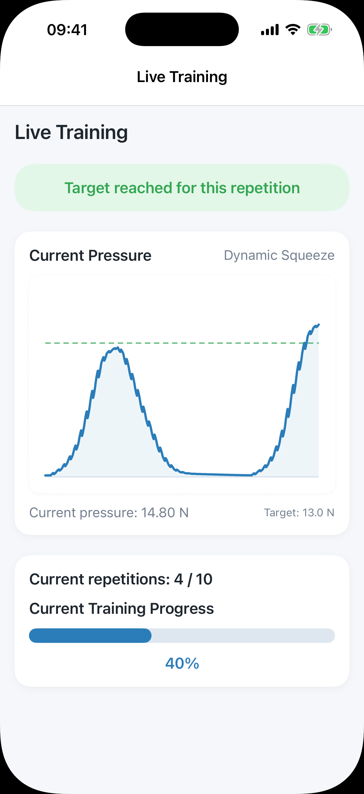
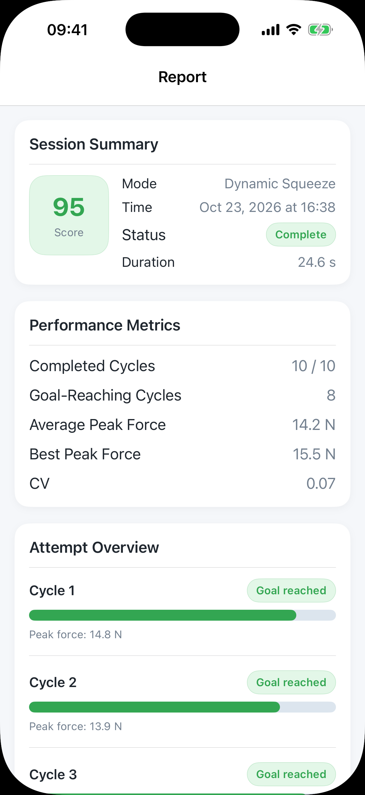
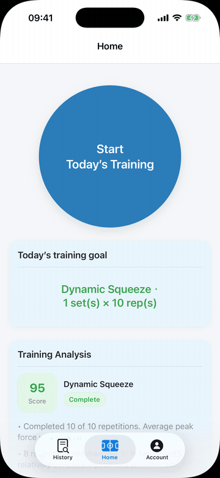

# SwallowEase

SwallowEase is an iOS companion app prototype for a sensor-assisted swallowing-training project. It connects to a Bluetooth Low Energy (BLE) force-measurement device, visualises pressure in real time, guides dynamic and static-hold exercises, and stores session results locally for progress review.

> Portfolio and research prototype. It is not a medical device and is not intended for diagnosis or treatment.

**Source code:** [github.com/So0onder/SwallowEase](https://github.com/So0onder/SwallowEase)

## App preview

<p align="center">
  
  
  
</p>

<p align="center"><em>Home dashboard · Live pressure training · Performance report</em></p>

## Demo

<p align="center">
  
</p>

The demo uses deterministic simulated sensor data when BLE hardware is unavailable. Dynamic sessions include repetition-to-repetition force variation, baseline drift, a primary pressure peak and a smaller shoulder; static sessions model ramp-up, fatigue, tremor and brief pressure drops.

## Highlights

- Native iOS interface built with SwiftUI
- BLE device discovery, connection, and live `Float32` pressure data
- Dynamic repetition and static-hold training modes
- Real-time coaching, force curve, repetition tracking, and completion feedback
- Local session history with day and session detail views
- Performance summaries covering completion, target achievement, consistency, and action validity
- Configurable schedule, repetitions, sets, and hold duration

## Tech stack

- Swift 5
- SwiftUI
- CoreBluetooth
- Combine
- Codable and local JSON persistence
- Xcode 26 / iOS 17.6+

## BLE protocol

The prototype targets a device named `ForceMeter` and uses the Nordic UART Service-compatible UUIDs below:

- Service: `6E400001-B5A3-F393-E0A9-E50E24DCCA9E`
- Notify characteristic: `6E400003-B5A3-F393-E0A9-E50E24DCCA9E`
- Payload: the first four bytes are interpreted as a little-endian IEEE 754 `Float32` pressure value in newtons

## Run locally

1. Open `swallowingball.xcodeproj` in Xcode.
2. Select an iPhone simulator or a physical iOS device.
3. Choose your own development team if you are running on a physical device.
4. Build and run the `swallowingball` scheme.

The interface can be explored without the external sensor. Live pressure input requires a compatible BLE device.

## Project structure

```text
swallowingball/
├── BluetoothManager.swift     # BLE discovery, connection, and pressure parsing
├── LiveTrainingView.swift     # Real-time training workflow
├── TrainingAnalysis.swift     # Metrics, scoring, and summaries
├── TrainingModels.swift       # Session and attempt data models
├── TrainingStore.swift        # Local session persistence
├── HomeView.swift             # Dashboard and training entry point
├── HistoryView.swift          # Historical progress
├── ReportDetailView.swift     # Session report
└── AccountView.swift          # Profile, plan, and device settings
```

## Privacy

Profile settings and training sessions are stored locally on the device. The current prototype does not upload them to a server.

## Status

This repository contains a functional research/portfolio prototype and is under active development. Hardware behaviour depends on the matching sensor firmware and calibration.

## Copyright

Copyright © 2026 Jingwen Liu. All rights reserved. The source code is shared for portfolio review; no licence for reuse or redistribution is granted.
